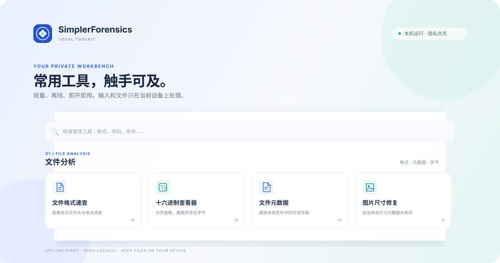

  
  <h1>SimplerForensics</h1>
  
<strong>轻量、离线、即开即用的本地工具集</strong>

  
面向文件分析、数据处理和数字取证日常工作的浏览器工具箱。

  

    
    
    
    
  

> 文件和输入内容默认留在当前设备；页面无需构建或安装项目依赖。APK 静态分析需要在本机准备 JADX。

## 🧭 工具一览

| 文件分析 | 移动与媒体 |
|:--|:--|
|  [文件格式速查](signatures/index.html) ·  [十六进制查看器](hex-viewer/index.html) ·  [元数据查看](metadata-viewer/index.html) ·  [文件伪装分析](file-disguise/index.html)   [图片尺寸修复](image-fix/index.html) ·  [EXE 静态分析](exe-analysis/index.html) ·  [CA 证书分析](ca-certificate/index.html) |  [APK 元数据解析](apk/index.html) ·  [二维码识别](qr-reader/index.html) |
| 数据处理 | 资料检索 |
|:--|:--|
|  [手机号归属地](phone-lookup/index.html) ·  [Base64 编解码](base64/index.html) ·  [图片 Base64](image-base64/index.html) ·  [时间戳转换](timestamp/index.html) ·  [密文字典匹配](ciphertext/index.html) |  [Linux 指令检索](linux/index.html) ·  [代码指令检索](code-commands/index.html) ·  [Windows 配置指南](windows/index.html) |

## 🚀 快速启动

推荐双击对应系统的启动脚本：

- **macOS**：`launch.command`
- **Windows**：`launch.bat`

启动脚本会在本机 `127.0.0.1` 打开网页服务，不需要 Python。也可以用 Chrome 或 Edge 直接打开根目录的 `index.html`；部分浏览器会限制从 `file://` 页面打开其他本地页面。若 macOS 浏览器显示 `ERR_ACCESS_DENIED`，请使用 `launch.command`。如果提示 Ruby/WEBrick 不可用，可尝试直接打开入口页。

---

## 各工具说明

### 密文字典匹配

在页面中选择 ciphertext/dicts 文件夹，或手动选择 TXT 字典文件。支持自动检测和指定 MD5、SHA-1、SHA-256、SHA-384、SHA-512、bcrypt 及 Django 格式 PBKDF2-SHA256。可选输入额外 Salt 文本，并选择将其直接拼接到字典明文前或后（不加分隔符），再对拼接后的候选文本进行匹配；结果会同时显示原始字典明文和实际参与哈希的文本。浏览器因本地文件安全限制，不会在未选择的情况下读取相邻文件。若希望按从易到难的顺序尝试字典，可在文件名前添加 00-、10- 等编号。bcrypt.js 浏览器实现及许可证见 ciphertext/BCRYPT-LICENSE.txt。

### 文件与图片分析

十六进制查看器按需读取文件页，可按十进制或十六进制偏移跳转、分块搜索字节或 UTF-8 文本，并将指定范围导出为派生文件。文件元数据查看依据内容签名支持 JPEG、TIFF、PNG、WebP、PDF 和 WAV；结果显示字段偏移，并提示未支持的编码、压缩对象或解析范围。两者均在浏览器本地运行，保持源文件不变。

文件签名速查表内置常见格式，也支持添加保存在当前浏览器中的自定义记录。图片尺寸工具支持单张或批量处理 JPEG、PNG 和 WebP，可多选图片或导入文件夹，并将统一目标宽高应用到选中的文件；只修改尺寸元数据（PNG 还会更新 IHDR 校验值），逐张下载新副本，不会覆盖原图。工具给出的“真实尺寸候选”是启发式提示，应结合其他线索判断。

文件伪装分析会在浏览器本地比对常见文件头与扩展名、分块扫描内部签名，并检查 PNG/JPEG 结束标记和 RIFF 容器长度线索；它也可以根据疑似偏移生成拆分命令。扫描上限为 512 MiB，提供扫描进度与取消操作。

隐写初筛统计 PNG 解压像素和 PCM WAV 样本的低位分布。统计异常可能由正常的嵌套容器或数据造成，不能单独证明文件含有隐写内容。JPEG 系数和压缩音视频帧需要专用工具进一步分析。

新增或改造工具应遵循 [工具设计规范](docs/TOOL_DESIGN_SPEC.md)，特别是证据边界、偏移记录、资源上限、可访问状态反馈和非破坏性处理约定。

### 图片 Base64 转换

页面位于 `image-base64/`，支持图片转 Base64/Data URL，以及把 Base64 文本还原为图片。编码只读取原始文件字节，不重新压缩或转码像素；解码按文件头识别 PNG、JPEG、GIF、WebP、BMP、ICO、TIFF、AVIF、HEIC 和 SVG，并在 Data URL 声明类型与实际格式不一致时提示。Base64、Data URL 和带换行/空白的输入均可解析；单张图片和解码结果上限为 32 MiB，Base64 输入上限约 5000 万字符。工具可复制或下载文本，也可下载还原后的图片副本；Base64 只是编码，不提供加密保护。

### EXE 静态分析

EXE 静态分析页面位于 exe-analysis/。支持本地计算 MD5、SHA-1、SHA-256、SHA-384 和 SHA-512，解析 PE32/PE32+ 头部、节区、导入/导出表和常见结构异常，基于 PE 元数据、运行时标记和可见字符串推测编程语言与工具链，并提取 ASCII/UTF-16LE 字符串、筛选 URL/IP/注册表路径线索、扫描内置静态规则，并可导入本地 JSON 文本规则。文件在浏览器 Web Worker 中处理，不执行样本、不上传文件、不调用在线信誉、扫描或规则服务；报告只有在用户点击导出后才下载为 JSON。

语言和编译器判断、结构提示及规则命中均为静态线索，可能误报或漏报。PE 时间戳不应视为可信编译时间；字符串命中不证明对应行为发生；未命中规则也不代表文件安全。首版单文件上限为 128 MiB，规则扫描使用内置特征和可选本地 JSON 文本规则，不等同于完整 YARA 引擎；规则格式示例见 exe-analysis/rules-example.json。

### APK 分析与 JADX

APK 分析页面调用本机 JADX。成功读取 APK 的 Manifest 后，页面会显示应用名称、包名、版本、主入口、Android API 级别和权限，并提供常见权限的中文说明。代码分析会标出网络、定位、相机或录音、WebView、动态加载、加密、设备标识、剪贴板和文件访问等 API 特征及其源码位置，并搜索静态网址。

这些结果是静态分析线索，不代表应用运行时一定执行了对应行为。混淆、动态加载、运行时拼接或加密，以及从网络下载的内容，都可能导致结果不完整。

项目提供跨平台便携运行包，内含 JADX 1.5.6 CLI 和 Temurin JRE 17，支持 macOS Intel/Apple Silicon、Linux x64/ARM64 和 Windows x64；目标电脑无需预装 Java。首次准备运行包时，在一台可联网的电脑上运行：

- macOS / Linux：sh scripts/setup-jadx.sh
- Windows：powershell -ExecutionPolicy Bypass -File scripts/setup-jadx.ps1

安装脚本从 JADX 官方发行页和 Adoptium 下载文件，并生成 jadx-portable-bundle.zip。将压缩包复制到目标电脑后，解压到项目的 tools 目录；本地服务会根据操作系统和 CPU 架构选择对应的 JRE。压缩包和解压后的 tools/jadx/ 均由 .gitignore 排除。通过 Git 获取项目后，可单独复制运行包，或在目标电脑运行安装脚本重新准备。

### 二维码识别

二维码识别使用本地打包的 [jsQR 1.4.0](https://github.com/cozmo/jsQR) 解码图片。识别结果只显示在当前浏览器中；许可证文本见 assets/vendor/jsQR-LICENSE.txt。

### CA 证书分析

CA 证书分析位于 `ca-certificate/`，可粘贴单张或多张 PEM `CERTIFICATE` 块，也可粘贴单张 Base64 DER 证书。页面在浏览器本机解析 X.509 主题、颁发者、序列号、有效期、公钥算法、SHA-256 指纹及常见扩展。CA 标签依据 Basic Constraints；证书签名用途依据 Key Usage 单独显示。

有效期仅与本机时间比较。工具不验证证书签名、信任链、主机名或吊销状态，也不联网获取 OCSP/CRL；未知扩展会显示 OID 和原始值，不会推断其语义。支持 DER 编码 X.509 证书，不支持 PKCS#7、PKCS#12 或私钥。

### 手机号归属地查询

页面位于 `phone-lookup/`，附带 [jieeit/phone](https://github.com/jieeit/phone) 发布的截至 2026 年 5 月离线号段数据库（约 52 万条），按号码前 7 位查询省市及运营商；支持文本、VCF/vCard、LDIF、CSV/TSV、XLSX、XLS、ODS、JSON/JSONL、XML、HTML、SQL、日志、SQLite/Access 等多种格式的本地号码提取、去重、统计和 CSV 导出。多行粘贴和表格批量导入会逐条识别；疑似无效号码会单独列出，并保留来源和原文上下文。Office Open XML ZIP 文档可结构化读取；其他二进制数据库按可读文本尽力扫描，不保证提取压缩、加密或二进制字段。归属地表示号段登记地，不是持有人实时位置，携号转网也可能导致当前运营商与号段记录不一致。数据源及 MIT 许可证随 `phone-lookup/data/` 一同提供。

### Linux 指令检索

命令按用途分类，支持按命令名、中文关键词、近似拼写、配置路径和示例搜索，也可复制示例。离线数据位于 linux/data.js、linux/supplement.js 和 linux/paths.js。命令条目优先链接菜鸟教程；没有对应页面时链接官方文档或手册页。页面也介绍 Linux 关键目录与配置文件的用途和维护方式。索引包含磁盘/分区 UUID、SMBIOS/DMI 硬件 UUID、LUKS/LVM/RAID/Btrfs 标识、machine-id 的读取与 UUID 生成/解析命令，以及 MD5、SHA-1、SHA-224、SHA-256、SHA-384、SHA-512、BLAKE2 等摘要计算与校验命令；并补充硬件信息、登录审计、SELinux/AppArmor、防火墙、权限能力与性能排查命令。菜鸟教程中的低频命令经过筛选；《Tutorial.md》中的命令和示例均已纳入索引。

## 隐私与联网

网页服务只绑定 127.0.0.1，不会向局域网或互联网开放。APK 文件和 JADX 生成的临时文件均在本机处理，不会上传到远程服务。除首次准备 JADX 便携运行包时从官方发行页和 Adoptium 下载文件外，其他页面不加载远程脚本、字体或 API。

## 开源致谢

感谢 [JADX 项目](https://github.com/skylot/jadx)的维护者和贡献者提供优秀的 Android APK 反编译工具。本项目通过 JADX 进行本机 APK 静态分析；JADX 使用 Apache-2.0 许可证。便携运行包使用 [Adoptium Temurin](https://adoptium.net/) 提供的 Java 运行时，感谢 Adoptium 社区的维护和发布。

二维码识别使用 [jsQR](https://github.com/cozmo/jsQR)，感谢其维护者和贡献者；项目采用 Apache-2.0 许可证，文本见 assets/vendor/jsQR-LICENSE.txt。

密文字典匹配使用 [bcrypt.js 2.4.3](https://github.com/dcodeIO/bcrypt.js) 验证 bcrypt 候选值，感谢 Daniel Wirtz 及贡献者；bcrypt.js 采用 BSD-3-Clause 许可证。其内嵌的 ISAAC 随机数实现感谢 Yves-Marie K. Rinquin，采用 MIT 许可证。相关许可文本见 ciphertext/BCRYPT-LICENSE.txt。

手机号归属地查询使用 [jieeit/phone](https://github.com/jieeit/phone) 发布的离线号段数据，感谢 Jieeit 整理并分享数据；数据采用 MIT 许可证，文本见 phone-lookup/data/LICENSE-MIT.txt。Linux 指令索引筛选并链接了[菜鸟教程](https://www.runoob.com/)的内容，感谢菜鸟教程提供学习资料。
